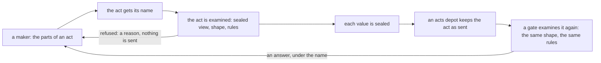
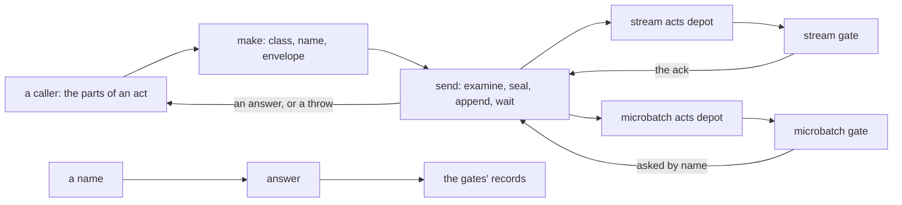

# Store — the act and the door

[Parent: namespace root](../README.md) · [Store source entry](../../README.md).

This folder holds the runtime's side of the store: the code that runs in the
program that is a client of the module. It has two parts.

The act is the one form of what a maker gives to the store, and the check of that
form. The door takes the parts of an act from a caller, puts the act in its
envelope, seals its values, appends it to an acts depot, and gives back the answer
of the gate that decided it. It also finds a recorded answer from a name.

The module owns durable state. The door owns borrowed handles and process memory.
The act owns nothing.

| File | Responsibility | State and lifetime |
|---|---|---|
| [act.clj](act.clj) | The declared shape of an act, the rules that a shape cannot say, the check that reads both, the names, the stand-in sealed form with which a maker examines an act, and the digest. Pure code. | One constant: the secret of the digest, which is a throwaway. No handle and no memory. |
| [door.clj](door.clj) | The one entry for acts into stream layers and microbatch layers: make an act, send it, find an answer by name. | A door is the map that `connect` gives: seven foreign handles on one module, and one atom of process memory. The memory holds leased locks not yet used, and the sealed form of each act with no answer yet. It is lost with the process. The namespace gives no way to close the handles. |

## The act

The form of an act is declared, not implied. [act.clj](act.clj) holds two
declarations as plain data, and they are the place to start:

- the shape: the parts of an act, what each part holds, which parts must be
  there, and the reason word when a part is wrong; and the same for a fact, a
  name, a fact id and a permission id;
- the rules: what must hold between two places of an act, which a shape cannot
  say.

The check holds no knowledge of the form. It reads the two declarations: first the
shape, part by part in the order declared, then the rules in their order. So the
order of the declarations is the order of the reasons.

Code is in three places only, and each is small: the leaves, which are the few
shapes that a declaration cannot say in data (an id, a value, bytes); the engine
that reads a shape; and one function for each rule.

The shape is compiled with the store. It is not a fact in the store, because each
shape that a tool gives enters the store as a fact inside an act; the act's own
shape must hold when each fact is wrong.

## How the act leads to the door

What follows is what the two parts are for. The second list says where the code
is today.

Intended, step by step:

1. A maker gives the door the parts of an act. The door adds no fact.
2. The act gives the door a name for it, before any gate reads it.
3. The door examines the act before anything is leased, sealed or appended. A
   maker's act holds plain values, and the one form holds sealed ones, so the
   door examines the sealed view of the act against the declared shape and the
   rules. An act that fails goes nowhere.
4. The door seals each value. What it appends has the one form.
5. A gate reads what the depot kept, and examines it with the same declarations.
   The door and the gate then cannot differ on what an act is.

Today:

- Steps 2, 3 and 5 do not use `act.clj`. The door and the gates take the act from
  the rig's envelope, which is another definition of an act, with another form.
  Only the [act's proof](../../../test-store/softland/store/act_proof.clj)
  requires `act.clj`.
- The reason is one thing: the store has no depots and no gates of its own. The
  door can only be run against the rig's module, and that module reads the rig's
  form.
- Two checks of step 3 are the door's own and are not in the act: a setting key
  about an entity that is not the act's layer, and a value with no session.

So the two parts do not meet yet, and the repository holds two definitions of the
one form. They become one when the gates that the door sends to read `act.clj`.

## The door

The diagram shows calls and dependencies, not one transaction. An append that
Rama took, a gate's decision, and a record that a read can find are distinct
stages:

- For a stream act `send` returns after the gate's event. The ack carries the
  gate's decision.
- For a microbatch act `send` waits for the append only, then asks by name until
  the batch that decided the act shows.
- An answer with no stamp was not recorded under the name. The door gives one for
  an act that it refuses before any append. A gate gives one for an act that it
  refuses on its face.
- After an error, or a wait that ran out, `send` appends the same sealed bytes
  again, and the gate answers a repeat from its record. `send` takes nothing from
  a sending that failed. After its bound it throws "no answer" with the name. It
  never returns "sent".

## Boundaries of the door

**Above the door.** A caller gives who, session, permission, layer and facts. It
never names a depot, a gate or a class: the door reads the class of the layer for
each act. No caller of the door is in this tree. The operator's acts, such as
making a layer or granting a permission, are converters and are not here. Nor is
promotion's side of the door.

**Below the door.** The door is a Rama client of one module, which it knows by
its name. That module is the rig's. The door requires four of the rig's
namespaces, for the code that the gates and the door must share:

- `rig.store.envelope`, required as `act`: the act as the rig's gates read it,
  with its parts, names, parse and sealed view. The gates and the door use this
  one copy. It is not `act.clj`.
- `rig.store.locks`: the seal, and the lock ids of a lease.
- `rig.store.gate`: the check for a misplaced setting, and the actors that cite no
  permission.
- `rig.store.micro`: the microbatch gate's parse, digest and fingerprint.

From the module the door uses the two acts depots, two PStates that it reads
directly (the settings of a layer, for its class; a stream answer by name), and
three queries (the leased locks of a session in a stream layer, the locks of a
lease in a microbatch layer, a microbatch answer by name). `connect` names each.
The record is not private, and the door does not read through the rig's read exit.

The lease road, the two waits and the choice of gate follow the rig's two doors,
`rig.store.client` and `rig.store.micro-client`. A function that differs from
them says how in its docstring.
