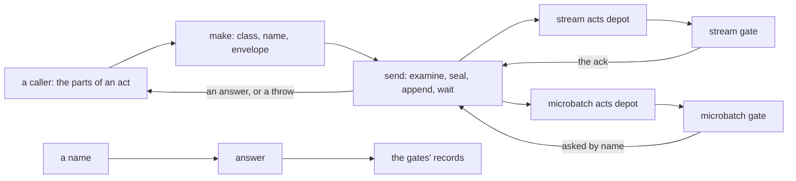

# Store — the door

[Parent: namespace root](../README.md) · [Store source entry](../../README.md).

This folder holds the runtime's side of the store: the code that runs in the
program that is a client of the module. It has one part, the door. The door takes
the parts of an act from a caller, puts the act in its envelope, seals its values,
appends it to an acts depot, and gives back the answer of the gate that decided
it. It also finds a recorded answer from a name. The module owns durable state;
the door owns borrowed handles and process memory.

| File | Responsibility | State and lifetime |
|---|---|---|
| [door.clj](door.clj) | The one entry for acts into stream layers and microbatch layers: make an act, send it, find an answer by name. | A door is the map that `connect` gives: seven foreign handles on one module, and one atom of process memory. The memory holds leased locks not yet used, and the sealed form of each act with no answer yet. It is lost with the process. The namespace gives no way to close the handles. |

The diagram shows calls and dependencies, not one transaction. An append that
Rama took, a gate's decision, and a record that a read can find are distinct
stages:

- For a stream act `send` returns after the gate's event. The ack carries the
  gate's decision.
- For a microbatch act `send` waits for the append only, then asks by name until
  the batch that decided the act shows.
- An answer with no stamp was not recorded under the name. The door gives one for
  an act that it refuses before any append. A gate gives one for an act that it
  refuses on its face.
- After an error, or a wait that ran out, `send` appends the same sealed bytes
  again, and the gate answers a repeat from its record. `send` takes nothing from
  a sending that failed. After its bound it throws "no answer" with the name. It
  never returns "sent".

## Boundaries

**Above the door.** A caller gives who, session, permission, layer and facts. It
never names a depot, a gate or a class: the door reads the class of the layer for
each act. No caller of the door is in this tree. The operator's acts, such as
making a layer or granting a permission, are converters and are not here. Nor is
promotion's side of the door.

**Below the door.** The door is a Rama client of one module, which it knows by
its name. That module is the rig's. The door requires four of the rig's
namespaces, for the code that the gates and the door must share:

- `rig.store.envelope`, required as `act`: the act itself, with its parts, names,
  parse and sealed view. One copy, which the gates and the door both use.
- `rig.store.locks`: the seal, and the lock ids of a lease.
- `rig.store.gate`: the check for a misplaced setting, and the actors that cite no
  permission.
- `rig.store.micro`: the microbatch gate's parse, digest and fingerprint.

From the module the door uses the two acts depots, two PStates that it reads
directly (the settings of a layer, for its class; a stream answer by name), and
three queries (the leased locks of a session in a stream layer, the locks of a
lease in a microbatch layer, a microbatch answer by name). `connect` names each.
The record is not private, and the door does not read through the rig's read exit.

The lease road, the two waits and the choice of gate follow the rig's two doors,
`rig.store.client` and `rig.store.micro-client`. A function that differs from
them says how in its docstring.
