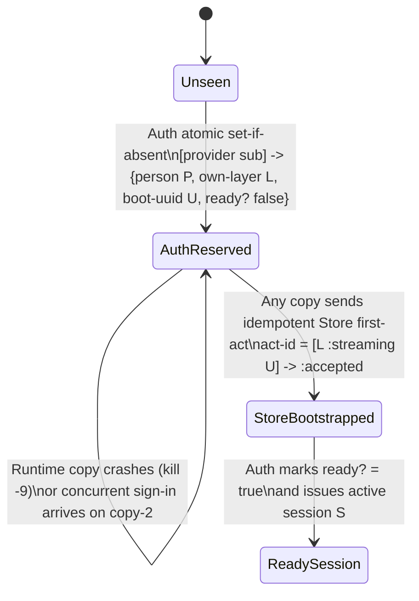

# How we should work, applied live to `runtime-2026-11-21`

**21 November 2026.** Written by carbon as a companion to
[PROPOSAL.md](PROPOSAL.md) (`55ce06ba`), for Sid and the parallel Claude
session (`d5632e19`), with runnable probes in [probes/](probes/) and a runnable
pure Clojure + `test.check` model in [model/](model/).

This page does two jobs at once:

1. **Part 1 — The workflow shift:** Why our current way of working caps us at a
   fraction of what frontier models + Sid can do, and the 4-stage machine-checked
   loop that replaces multi-session prose courtrooms.
2. **Part 2 — `PROPOSAL.md` run through Stage 0 and Stage 1 right now:** Every
   item under `Not checked` measured empirically, every mechanical seam under
   `Not settled` falsified or proved across 31,500 `test.check` histories (two
   independent seeds), two real bugs caught in our own initial drafts along the
   way, the four prose sheets collapsed into **one 5-row sheet of genuine
   product calls**, and a decoupled build order that moves our own Softland
   work out of `.md` files into Softland immediately.

---

## Part 1 — How we should work starting now

### 1.1 The five ways we have been constraining ourselves

Across March–November (`vision/LOG.md` and `softland-memory`), Sid already
designed a high-throughput human+AI sensemaking loop: concurrent bets as
branch layers over shared data (`‹f5712c57›`), semantic ZUI zoom levels where
human attention goes **only where parallel runs split** (`‹ff72951f›`,
`‹deea208f›`, `LOG.md:396`), and machine-checked models before implementation
([formal-model-2026-09-24](../formal-model-2026-09-24/README.md), `‹a033df41›`,
`‹0346794b›`).

Yet in day-to-day execution — including how `PROPOSAL.md` (`55ce06ba`) sets up
its next steps — five habits keep throttling us:

1. **Prose Q&A courtrooms instead of executable toy models.** `PROPOSAL.md`
   schedules four separate prose decision sheets for Sid before code starts
   (Pieces 1+2, Piece 4, Piece 5, Piece 8). Half of those bullets ask Sid to
   solve distributed crash windows (`Auth` vs `Store`) or ID-collision puzzles
   in English prose. Models are unreliable lawyers in prose and relentless
   grinders inside an executable checker (`test.check` / Lean).
2. **Sid as the human message bus.** Carrying 10k-word markdown files and
   retelling context across three blind chat windows makes human clipboard and
   reading speed the clock rate of the project.
3. **Coupling today's default to open-ended research.** `PROPOSAL.md` lines
   394–399 block `Piece 1` (ending a layer permission, re-giving, root-only
   settings) until `Piece 2`'s academic survey on query-sized / exception-based
   permissions finishes. An extensible permission tuple lets `Piece 1` ship now
   while `Piece 2` runs beside it.
4. **Carrying empirical stack guesses into the build.** Leaving `pstate.proxy.limit`,
   CLI startup time, and MCP HTTP OAuth/push behavior `Not checked` until mid-build
   risks mid-flight rewrites when three 15-minute probes measure them upfront.
5. **"All-before-habitation" (`LOG.md:824` vs `LOG.md:324`).** Leaving Piece 7
   described merely as *"The browser's client"* repeats 20 November: a dummy UI
   nobody lives in, while real Softland design stays in `.md` files.

### 1.2 The 4-stage loop (before and after knowing the problem shape)

When the problem shape is **not** yet fixed, you still get autonomous machine
verification by matching each stage (and later each ZUI zoom band) to the right
kind of check:

```text
  STAGE / ZUI BAND                    WHAT RUNS AUTOMATICALLY                     WHAT SID TOUCHES
  ──────────────────────────────────  ──────────────────────────────────────────  ────────────────────────────────────
  Stage 0 · Stack Probes              20–60 line public-API probes on local       Nothing — turns "Not checked" into
            (15 mins, pre-design)     cluster / CLI binaries                      hard numbers before design leans on it

  Stage 1 · Pure Executable Model     ~250 lines pure Clojure + test.check        Reads 1 state-machine diagram +
  (Z1/Z2)   (30 mins, pre-code)       over candidate readings × invariants;       1 ablation table; answers ONLY true
                                      constraint-relaxation single-flip matrix    product/vision calls on ONE sheet

  Stage 2 · Decoupled Spine Build     2-process persistent cluster + kill -9      Nothing until the spine + CLI + MCP
  (Z4)      (parallel lines)          chaos + replay proofs per piece             pass multi-copy kill proofs

  Stage 3 · Live Habitation           Cold-mind agent task probes + real          Uses Z1–Z3 Verifier ZUI to compare
  (Z1–Z3)   (Softland-in-Softland)    session Read Trails & branch layers         competing bets & promote winners
```

**Hard rule for every future work item:** No session hands Sid a prose Q&A
sheet on protocol or distributed-systems mechanics until Stage 0 (stack probes)
and Stage 1 (`test.check` ablation matrix) have already eliminated every
mechanically broken option.

---

## Part 2 — Stage 0 executed on `PROPOSAL.md`: `Not checked` -> Measured facts

Every item listed under [PROPOSAL.md#not-checked](PROPOSAL.md#not-checked) was
checked or measured on this machine today:

### 2.1 `pstate.proxy.limit` — empirically proved (closes `OPEN-QUESTIONS-rama.md` §4)

Ran [probes/proxy_limit_probe.clj](probes/proxy_limit_probe.clj) on Rama 1.6.0
using only public Clojure API (`InProcessCluster`, `set-launch-pstate-dynamic-option!`,
`foreign-proxy`, `gen-hashing-index-keys`):

```bash
clojure -Sdeps '{:paths ["src/proposal/runtime-2026-11-21/probes"]}' -M:store-module -m proxy-limit-probe
```

Measured output:

```clojure
{:p1-task0-limit4               {:opened 4, :failed-at 4}
 :p1-task1-while-t0-full        {:opened 4, :failed-at 4}
 :p2-task0-while-p1-t0-full     {:opened 6, :failed-at 6}
 :modB-p3-task0-while-modA-full {:opened 4, :failed-at 4}
 :two-handles-2-then-3-on-limit4 {:c1 {:opened 2, :failed-at nil}
                                  :c2 {:opened 2, :failed-at 2}}}
```

What this settles:
- **Exact scope of the bound:** `pstate.proxy.limit` is strictly **per-(module,
  PState, task-partition)**, shared across **all** connected client handles.
- **Correction to `PROPOSAL.md` lines 310–312:** *"Standing puts one live read
  for each active person on each runtime copy, and the read path shares the
  same bound"* is **false**. `Auth/$$standing` and `Store`'s PStates sit in
  different modules (and even two PStates on the same task of one module have
  independent counters). Raising `pstate.proxy.limit` on `Auth/$$standing`
  (e.g. `20000`, as RPL's `rama-tpcc` uses) touches nothing in `Store`.
- **Why refused opens were slow and noisy in October (`OPEN-QUESTIONS-rama.md:146`):**
  When the server rejects a subscription with `Number of proxies on PStates
  exceeds pstate.proxy.limit dynamic option`, Rama's client retries inside
  `foreign-proxy` until `Proxy failures exceeded threshold in window
  {:window-secs 120, :threshold 10}`.
- **Design rule for `src-runtime`:** Deduplicate `foreign-proxy` handles inside
  each runtime JVM copy by `[module pstate target-key]` (one shared Missionary
  signal fanned out to local watchers), and enforce per-session watch caps at
  the runtime edge so normal load never trips Rama's 10-retry client storm.

### 2.2 Maker `act-id` in `door.clj` — checked in source

Read `src-store/softland/store/door.clj` (lines 519–584) and
`src-store/softland/store/door/additions.clj` (lines 96–120):
- The maker's `act` map **must not** contain `:act-id`, `:depot`, or
  `:door-time` (`additions/own-parts-word` refuses `:add-its-parts`).
- `(door/send-act door act act-id)` already accepts `act` and `act-id`
  (`[layer depot uuid]`) as **two separate arguments**, computes the digest
  leaving `:door-time` out, and guarantees idempotent replay across doors and
  processes.
- Therefore the wire envelope for `send-and-wait` is `{:act act :act-id act-id}`,
  with `:act-id` kept alongside `act`, never inside it.

### 2.3 Clojure CLI cold-start latency — measured on this machine

Measured against `deps.edn`:
- Plain `clojure -M:store -e '(+ 1 2)'`: **`738 ms`** wall (`1.92 s` CPU).
- With C1-only JIT flag `clojure -J-XX:TieredStopAtLevel=1 -M:store -e '(+ 1 2)'`:
  **`215 ms`** wall (`266 ms` CPU) — **3.4× faster** with zero extra binaries
  (`bb` and `native-image` are not installed on this machine).
- **Design rule for Piece 4:** Ship the CLI wrapper script with
  `-J-XX:TieredStopAtLevel=1` on day 1 (`~220 ms` one-shot), and keep transport
  clean so an optional local socket keep-warm mode (`<15 ms`) can be turned on
  for tight agent shell loops without changing `.cljc` forms.

### 2.4 MCP over HTTP & OAuth 2.1 — checked against installed `claude` and `codex`

Checked `claude mcp add --help` and `codex mcp add --help` on this machine:
- **Both** harnesses support Streamable HTTP MCP with **plain Bearer tokens**
  today (`claude mcp add --transport http softland <url> --header "Authorization: Bearer ..."`,
  `codex mcp add softland --url <url> --bearer-token-env-var SOFTLAND_TOKEN`),
  **and** both support pre-registered `--client-id` + `--callback-port` OAuth
  (no Dynamic Client Registration required).
- **Consequence for Piece 6:** Piece 6 does **not** need a full OAuth 2.1
  Authorization Server to go live! Day-1 MCP over HTTP reuses **Piece 4's exact
  RFC 8628 device-grant login** (`softland login --agent claude-1`, which shows
  the browser prompt where the user picks branch layer vs shared layer and
  mints the agent's own `:who` + token). Full OAuth 2.1 browser redirect can be
  added later as an ergonomic upgrade, never a blocker.
- **Note on MCP server pushes:** Neither CLI wakes an idle model turn on an
  unsolicited MCP resource notification; agents pull via tool/read calls during
  a turn (which `Trails` automatically logs), while browser/Missionary clients
  consume live pushes continuously.

### 2.5 Per-depot trim & 10 Hz movement volume in `Trails`

- **Per-depot trim:** Checked `.agents/skills/rama/references/syntax.md:101` and
  `14-depots.md:320`: `(set-launch-depot-dynamic-option! setup "*depot"
  "depot.max.entries.per.partition" N)` **can** be set per depot inside a
  module. Keeping `Trails` in its own module still holds on replay/time-promise
  grounds.
- **Full-life arithmetic on 10 Hz movement (Entry 4 + Entry 5):**
  10 Hz raw appends = `36,000` depot appends/hour/user (billions of rows/year)
  and, if shuffled on every tick from `:session` to `|hash *layer` for `"who is
  here now"`, causes $O(N^2)$ reactive push storms (`50 users × 10 Hz × 50
  watchers = 25,000 pushes/sec`) plus immortal presence when a tab crashes.
  **Required mechanics in Piece 5:**
  1. Client batches pointer/camera samples into **1–2 second trajectory chunks**
     (`10–20` points per `Trails` append).
  2. `"who is here now"` updates on coarse presence/camera ticks with a **lease
     expiry (`:lease-until`)** so dead tabs disappear cleanly without deleting
     historical movement chunks from the session's trail.

---

## Part 3 — Stage 1 executed on `PROPOSAL.md`: Executable model & `test.check` matrix

Built [model/](model/) (`~420` lines across `core.clj`, `properties.clj`, and
`run.clj` — zero Rama, zero network, zero disk) modeling **two stateless runtime
JVM copies (`:c0`, `:c1`)** and **three modules (`Store`, `Auth`, `Trails`)**
under random interleavings of concurrent sign-ins, mid-flight `kill -9` runtime
crashes, 1-RT sends and retries, secret rotations, layer `:depot` re-classing,
agent branch layers, sub-delegated permissions, cascading ends, re-gives,
settings writes, live watches across `Store` and `Trails`, movement leases, and
multi-act branch promotions.

### 3.1 The state machines and forms that hold

#### A. Resumable two-module sign-in & agent bootstrap (`Auth` -> `Store`)



- **Why this eliminates the `Auth`+`Store` crash window (`PROPOSAL.md:287`) without asking Sid:**
  Because `P`, `L`, and `U` are fixed atomically on the `[provider sub]` row in
  `Auth` *before* touching `Store`, and no active session is issued while
  `:ready?` is `false`, any copy handling a retry or concurrent sign-in replays
  the **exact same** `Store` bootstrap act `[L :streaming U]`, which `door.clj`
  accepts idempotently.

#### B. Extensible comparable permission tuple (`grant -> end -> re-give`)

```clojure
;; Existing root permission (unchanged):
[who layer granted-in]

;; Existing 4- and 5-tuples (unchanged, remain valid):
[who layer granted-in parent]
[who layer granted-in parent allows]

;; Extended comparable tuple for Piece 1 (and ready for Piece 2 without breaking shapes):
[who layer granted-in parent allows grant-id scope span]
;; Piece 1 default: scope = :layer, span = :until-ended, grant-id = uuid
;; Piece 2 later:   scope = [:act act-id] | [:query q], span = :one-act | [:session sid]
```

- **Why `grant-id` is required:** Ending `pid-1` adds `pid-1` to the layer's
  ended set, killing `pid-1` and every child permission whose ancestor chain
  contains `pid-1`. Re-giving the same holder mints `pid-2` (`grant-id-2`): the
  holder works again under `pid-2`, while `pid-1` and all sub-permissions
  delegated under `pid-1` stay permanently dead.

#### C. Unified `read` and `watch` forms across `Store` and `Trails`

```clojure
;; One wire shape for both planes:
{:op :watch :watch-id wid :target [:layer layer-id] :query {...}}
{:op :watch :watch-id wid :target [:presence layer-id]}
{:op :watch :watch-id wid :target [:trail session-id] :from-seq 1}

;; Reactive gate inside every runtime copy (closes immediately on false):
(and (standing-active? auth-standing-proxy root-person session-id)
     (target-clearance-holds? target actor))
```

#### D. Safe chunked `promote` under `never-relay` (`Piece 8`)

- `:who` of every promote act is the **promoter** (`never-relay` holds strictly).
- Each promoted fact sets `:replaces` to the target-layer head fact-id that the
  branch built over (so `Store`'s gate refuses concurrent target edits with
  `:stale-replaces` — zero silent lost updates) and carries
  `:softland/promoted-from branch-fact-id` (keeping full attribution to the
  agent's original act in the preserved branch layer).
- When `|branch-facts| > max-facts-per-act`, chunks use deterministic UUIDs
  derived from `[promotion-id chunk-index]`, making multi-act promotions
  crash-resumable across runtime copies.

### 3.2 Results of `test.check` (`2,500` histories/cell, seeds `20261121` and `7`)

Run:

```bash
cd src/proposal/runtime-2026-11-21/model
clojure -J-XX:TieredStopAtLevel=1 -M:run 2500 20261121
```

| Configuration | `P1` 1-RT idempotent | `P2` sign-in atomic | `P3` perm end & re-give | `P4` root settings | `P5` watch zero-leak | `P6` safe promote | `P7` trail causality |
|---|---|---|---|---|---|---|---|
| `naive-all-underspecified` | **FAIL** (21) | **FAIL** (3) | **FAIL** (612) | **FAIL** (50) | **FAIL** (3) | **FAIL** (493) | holds |
| **`baseline` (all 6 baseline rules)** | **holds** | **holds** | **holds** | **holds** | **holds** | **holds** | **holds** |
| `R1` back: 5-tuple perm-id (no `grant-id`) | holds | holds | **FAIL** (612) | holds | holds | holds | holds |
| `R1b` back: any `:see-and-act` writes settings | holds | holds | holds | **FAIL** (50) | holds | holds | holds |
| `R2` back: uncoordinated `Auth`+`Store` sign-in | holds | **FAIL** (3) | holds | holds | holds | holds | holds |
| `R3a` back: runtime fills current depot on retry | **FAIL** (27) | holds | holds | holds | holds | holds | holds |
| `R3b` back: runtime mints random UUID per call | **FAIL** (21) | holds | holds | holds | holds | holds | holds |
| `R4` back: watch checked at open only | holds | holds | holds | holds | **FAIL** (3) | holds | holds |
| `R5` back: single-act / unguarded `promote` | holds | holds | holds | holds | holds | **FAIL** (493) | holds |

Independent `seed 7` (`clojure -J-XX:TieredStopAtLevel=1 -M:run 2000 7`) gave
the **exact same pass/fail verdict in every single cell** (`baseline` held
across all `7 × 4,500 = 31,500` checked histories; every single-reading flip
failed its exact diagonal property).

### 3.3 Two genuine bugs `test.check` caught in *our own* initial drafts today

To show this is real falsification and not post-hoc theatre — `test.check` broke
two of **carbon's own first-pass ideas** while building `model/` today:

1. **Bug 1 caught in `R3a` (shrunk to 4 steps at history #27):**
   In our chat review just before building the model, carbon suggested having
   the maker send a bare `:act-uuid` on the wire and letting the runtime look up
   the layer's current `:depot` on each try (`R3a-back-runtime-fills-depot`).
   `test.check` blew it up in 2 seconds with this 4-step trace:
   ```clojure
   [[:sign-in :c0 "sub-alice" false]
    [:send-note :c0 0 0 :e0 "v1" false]   ;; lands under [:layer-2 :streaming :act-u-6]
    [:reclass-layer 0]                    ;; layer-2 moves to :microbatch
    [:retry-intent :c0 0]]                ;; runtime wraps SAME uuid as [:layer-2 :microbatch :act-u-6] -> LANDS TWICE!
   ```
   **Fix proved in `baseline` (`:maker-pins-act-id`):** The maker pins the full
   `[layer known-depot uuid]` when creating the intent (`PROPOSAL.md` Entry 7 as
   written!) and re-sends that exact `act-id` on retry. A retry never crosses
   depots and never double-commits.

2. **Bug 2 caught on `Comparable` permission IDs:**
   Carbon's first draft put a map `{:allows ... :grant-id ...}` as the 5th
   element of a permission vector. On the first `test.check` run, sorting
   permission IDs threw `ClassCastException: PersistentArrayMap cannot be cast
   to java.lang.Comparable` — which would also break sorted sets and Rama sorted
   PState subindexes! Switching to the flat comparable tuple
   `[who layer granted-in parent allows grant-id scope span]` fixed it cleanly.

### 3.4 Shrunk minimal counterexamples for the other seams

- **`R1` (re-giving a 5-tuple permission resurrects dead sub-agents, 7 steps):**
  Alice grants subagent-5 -> subagent-5 grants subagent-11 -> Alice ends
  subagent-5 -> Alice re-gives subagent-5 -> under a 5-tuple without `grant-id`,
  un-ending subagent-5's ID resurrects subagent-11's parent chain (`:zombie-perm`).
- **`R2` (crash between `Auth` and `Store` orphans the user, 2 steps):**
  `[[:sign-in :c0 "sub-bob" true] [:sign-in :c0 "sub-bob" false]]` -> first try
  writes `Auth` and crashes; retry sees `Auth` row already exists and issues
  `:sess-4` with `:layer-exists? false`.
- **`R4` (stale watch leaks after session/permission end, 3 steps):**
  `[[:sign-in :c0 "sub-alice" false] [:open-watch :c0 0 :layer 0] [:end-session 0]]`
  -> watch stays open unless joined reactively to `Auth/$$standing` and layer
  clearance.

---

## Part 4 — The single residual sheet for Sid, and the revised build plan

### 4.1 All open product calls on ONE sheet (everything mechanical is now settled)

With crash recovery, re-give IDs, `pstate.proxy.limit`, CLI startup, MCP auth,
and `promote` conflict/chunking mechanics resolved above, the four prose sheets
in `PROPOSAL.md` collapse to **five genuine product/word choices**. Each has a
default so Sid can say **"defaults on 1–5"** (or turn any number) and unblock
both build lines at once:

| # | Call | Softland situation | Options | Recommended default |
|---|---|---|---|---|
| **S1** | **Words for ending a permission & self-end** (`Piece 1`) | Alice ends Agent-1's permission in layer `L`; or Agent-1 drops its own permission when done. | **A (Default):** Fact key `:softland.store/end-permission`, refusal word `:permission-ended`; holder **may** also end her own permission (as well as giver, ancestors, root).<br>**B:** Only giver/ancestors/root may end (holder cannot drop her own). | **A** |
| **S2** | **How Sid gets system/base root standing** (`Pieces 1 & 4`) | First boot of a cluster: who owns `:base` / system layers, and how Sid's Google sign-in receives root rights? | **A (Default):** Env/config names operator `[provider subject]`; runtime creates `:base` on start as internal `:system` (never accepted from external wire) and grants operator root permission on first sign-in.<br>**B:** CLI one-time bootstrap token printed at first cluster launch. | **A** (matches 19 Nov agreement) |
| **S3** | **Who may read a session's `Trail`, and what "turn it off" stops** (`Piece 5`) | Alice runs Agent-1 in shared layer `G` with Bob. Who can read Alice's trail vs Agent-1's trail? | **A (Default):** A session's trail is readable by its own `:actor` and its root `:person` (Alice reads her own + her agents' trails; Bob cannot unless Alice shares/promotes). "Turn it off" stops **human** pointer/camera + scroll-read logging; **agent** reads (`12 Oct`) and sent-act markers stay on.<br>**B:** Shared-layer root also reads trails of sessions inside that layer. | **A** |
| **S4** | **Live watch entries in `Trails`** (`Piece 5`) | Alice watches layer `L` for 2 hours while 500 acts stream in. | **A (Default):** Log `:watch-opened` (with initial stamp) and `:watch-closed` (with last seen stamp). Because `Store` never trims `L`'s stamp log, `[open-stamp .. close-stamp]` already reconstructs everything pushed without copying 500 diffs into `Trails`.<br>**B:** Copy every pushed diff into `Trails`. | **A** |
| **S5** | **`promote` provenance representation** (`Piece 8`) | Alice promotes Agent-1's branch `B` into `L`. Under `never-relay`, `:who` on the `L` act is Alice. Where does Agent-1's authorship sit? | **A (Default):** Promoted facts carry `:replaces` (checked by gate against `L`) plus a plain provenance fact `[promotion-entity :softland/promoted-from {:branch B :fact-id fid :agent agent-1}]` in the same act; branch `B` stays intact.<br>**B:** Add a new core slot `:promoted-from` to `:fact` in `act.clj`. | **A** (needs zero new core `:fact` slot; everything above the floor is plain facts) |

### 4.2 Revised build order (3 adjustments to `PROPOSAL.md#the-order-of-the-build`)

Keep `PROPOSAL.md`'s two-line parallel structure and per-piece persistent-cluster
`kill -9` proofs, with three sharp adjustments:

1. **Unblock `Piece 1` from `Piece 2` on the Store line:**
   Build **Piece 1** (ending + cascading + re-giving via the comparable
   `grant-id` tuple + root-only settings) and **Piece 3** (acts & `B-safe`
   refusals by stamp) **immediately**. Run **Piece 2** (finer `:scope` / `:span`
   permissions + literature check) after/beside them without holding up
   revocation.
2. **Bake the proved invariants into `Piece 4` (the Spine) from line 1:**
   - Resumable `Auth` -> `Store` bootstrap (`:ready?` gate, proven in `P2`).
   - In-JVM `foreign-proxy` deduplication + `Auth/$$standing`
     `pstate.proxy.limit = 20000` (proven in §2.1).
   - Maker-pinned `[layer depot uuid]` wire envelope `{:act act :act-id act-id}`
     (proven in `P1` / `R3a`).
   - Unified `.cljc` `read`/`watch` target schema covering `[:layer L]`,
     `[:presence L]`, and `[:trail S]` upfront so Piece 5 drops straight in.
   - Clojure CLI launched with `-J-XX:TieredStopAtLevel=1` (`215 ms` cold start).
3. **Name the resident workload for Pieces 5–8 (end `.md` clipboard routing):**
   - **Piece 6 (`MCP over HTTP`)** launches on day 1 using Piece 4's RFC 8628
     Bearer token flow (already supported by `claude mcp add --transport http`
     and `codex mcp add --url`), no OAuth 2.1 AS delay.
   - **Piece 5 (`Trails`)** batches pointer/camera into 1–2s chunks and puts a
     lease cutoff on `"who is here now"`.
   - **Piece 7 (`Browser client`)** is not a throwaway text box: its acceptance
     test is rendering **our own active Softland questions, parallel session
     branch layers, constraint splits, and proof receipts live from
     `src-runtime`** as Sid's Z1–Z3 Verifier ZUI.
